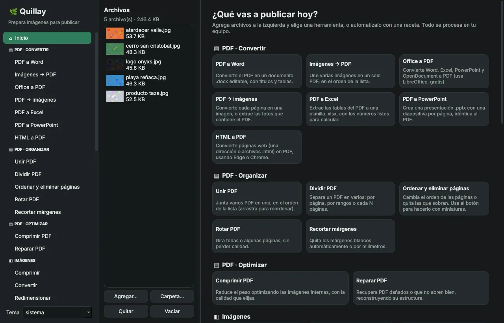

<div align="center">

[Español](README.md) · **English**


# Quillay

### Everything for your PDFs and images. Nothing leaves your computer.

A free multi-tool with 35+ features: convert, merge, compress, sign and redact PDFs; transform and shrink images; get files ready for the web and social media. Unlike online services, **it never uploads your documents to anyone's server**.

[](https://github.com/Sajnovich/Quillay/actions/workflows/ci.yml)


[](LICENSE)
[](https://github.com/Sajnovich/Quillay/stargazers)

**[Download](https://github.com/Sajnovich/Quillay/releases/latest)** · [Contributing](CONTRIBUTING.md) · [Report a bug](https://github.com/Sajnovich/Quillay/issues/new/choose)



</div>

> [!NOTE]
> The interface is currently in **Spanish**. An English translation is on the roadmap, and help is very welcome!

> 🏔️ **Why "Quillay"?** The quillay is a native Chilean tree with many uses: its bark was used as soap for generations, it is used in food and drinks today, and its compounds are even found in vaccines. Quillay, the app, is the same: one tool for almost everything you do with PDFs and images. The logo is a document page with the snowy Andes, the mountains you see from Santiago, where the project was born.

> [!TIP]
> **Find Quillay useful?** Give it a ⭐. It takes one second and helps others discover it.

## What makes Quillay different

- **Nothing leaves your computer.** Contracts, signed documents or photos with GPS never travel to someone else's server. No accounts, no daily limits, works offline (it only goes online when you check for updates or install LibreOffice).
- **One app instead of ten websites.** PDFs, images, web and privacy in one place, 1 or 500 files at a time.
- **Real privacy.** Redaction that deletes text (not just covers it), GPS detection in photos and face blurring.
- **Reusable recipes.** Save a chain of steps (fit → watermark → WebP without GPS) and repeat it with one click or one command.
- **First-class command line.** Every tool is also a command (`quillay unir_pdf *.pdf`), generated from the same code as the window.

## Tools

| Category | Tools |
|---|---|
| **Automate** | Recipes (5 built-in + your own) |
| **Web** | Favicons & app icons · Responsive images (`<picture>`/`srcset`) · Social media sizes · Brand colors (CSS variables) · Loading placeholders (LQIP) |
| **Privacy** | GPS & metadata check and cleanup · Face blurring · Duplicate finder |
| **Editing** | Convert · Compress · Resize · Crop · Fit to size · Watermark · Batch rename |
| **PDF** | Merge · Split · Reorder & delete pages (drag thumbnails) · Rotate · Crop margins · Compress · Repair · Images ↔ PDF · Extract images · PDF → Word/PowerPoint/Excel · Office/HTML → PDF · Page numbers · Watermark · Fill forms from a spreadsheet · Compare · Password protect · Unlock · Properties · Sign (visual + digital certificate) · True redaction |

Supported formats: JPG, PNG, WebP, AVIF, HEIC, TIFF, BMP, GIF and ICO.

## Install

**Ready-to-run app:** grab the file for Windows, macOS or Linux from [Releases](https://github.com/Sajnovich/Quillay/releases/latest).

**With Python 3.11+:**

```bash
git clone https://github.com/Sajnovich/Quillay.git
cd Quillay
python3 -m venv .venv && source .venv/bin/activate   # Windows: .venv\Scripts\activate
pip install -e ".[gui]"
quillay-gui
```

## Command line

```bash
quillay herramientas                                  # list all tools
quillay convertir photos/ --formato webp --calidad 80
quillay favicons logo.png --nombre-sitio "My site"
quillay metadatos photo.jpg                           # does it have GPS?
quillay receta correr web-optimizado photos/ -o ready/
```

Commands and options are in Spanish for now; `quillay <tool> --help` lists everything.

## Contributing

Contributions of every size are welcome: bug reports, ideas, recipes, docs, **translations** and code. Start with [CONTRIBUTING.md](CONTRIBUTING.md) (in Spanish; feel free to open issues and PRs in English) and look for issues labeled [`buena primera tarea`](https://github.com/Sajnovich/Quillay/labels/buena%20primera%20tarea) (good first issue).

## License

[MIT](LICENSE) © 2026 Eduardo Sajnovich. Made in Chile 🇨🇱 for everyone.
