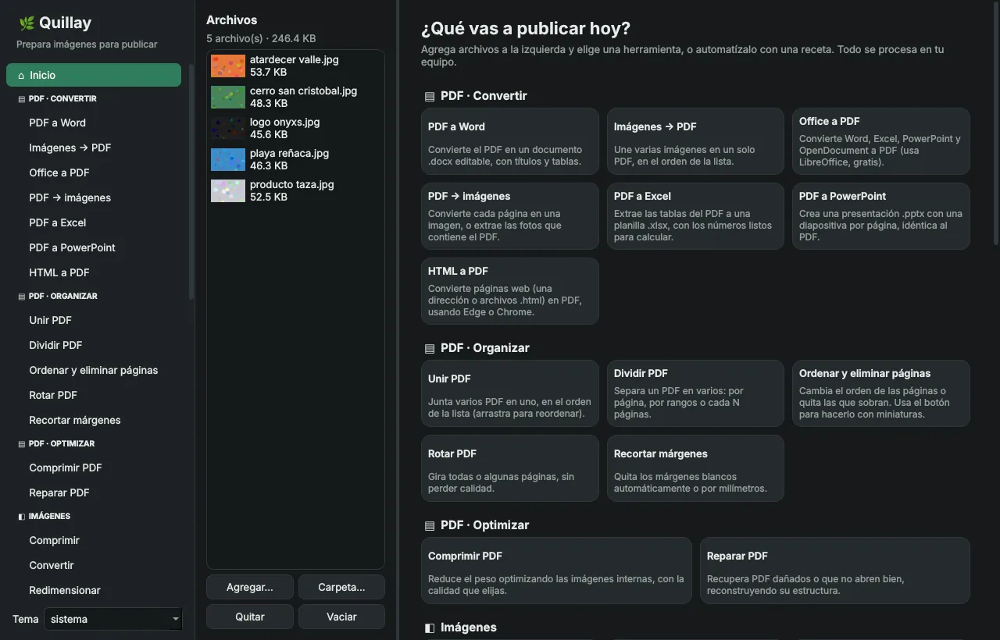
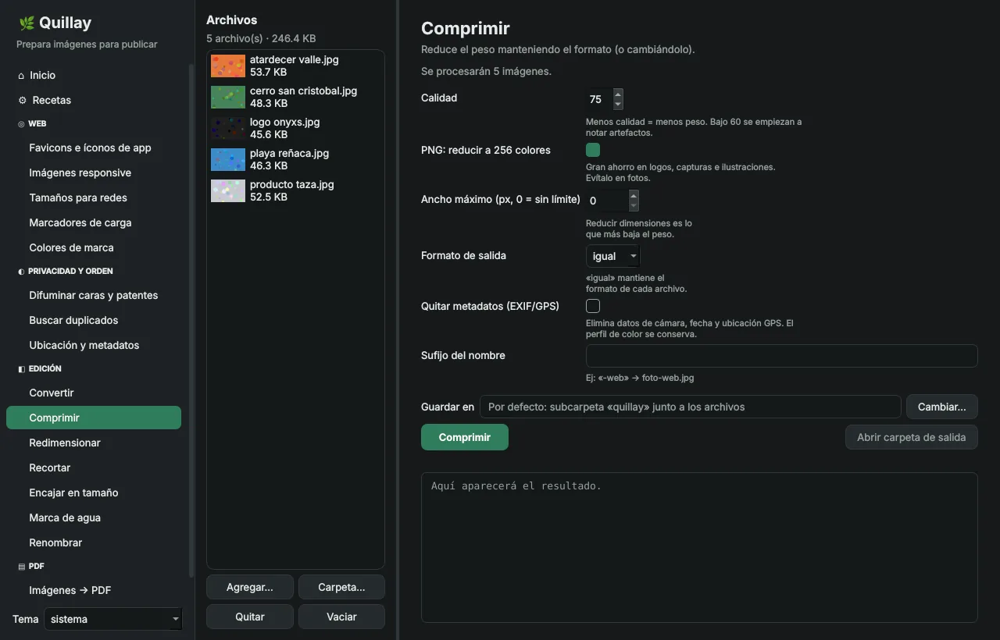
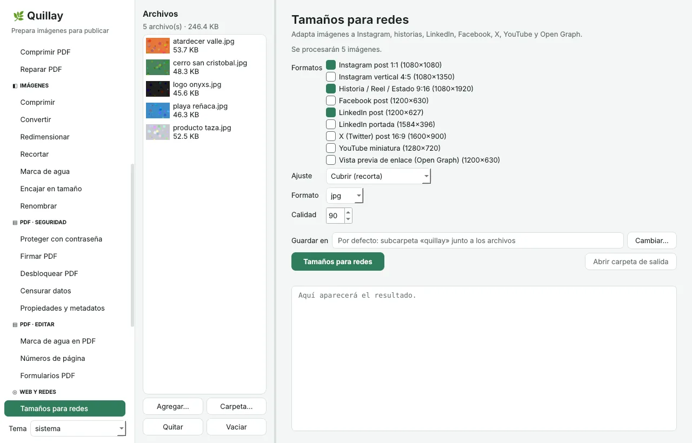
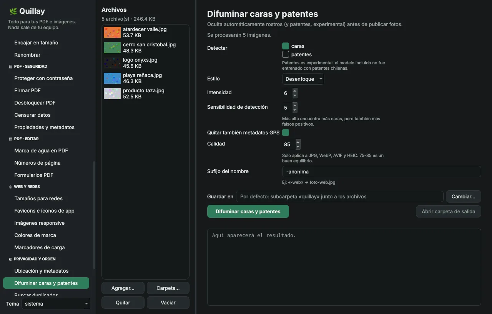
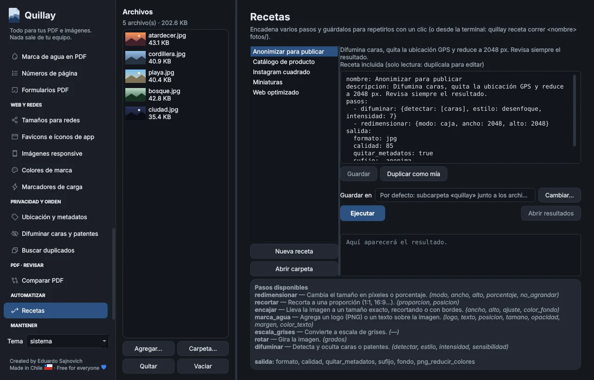
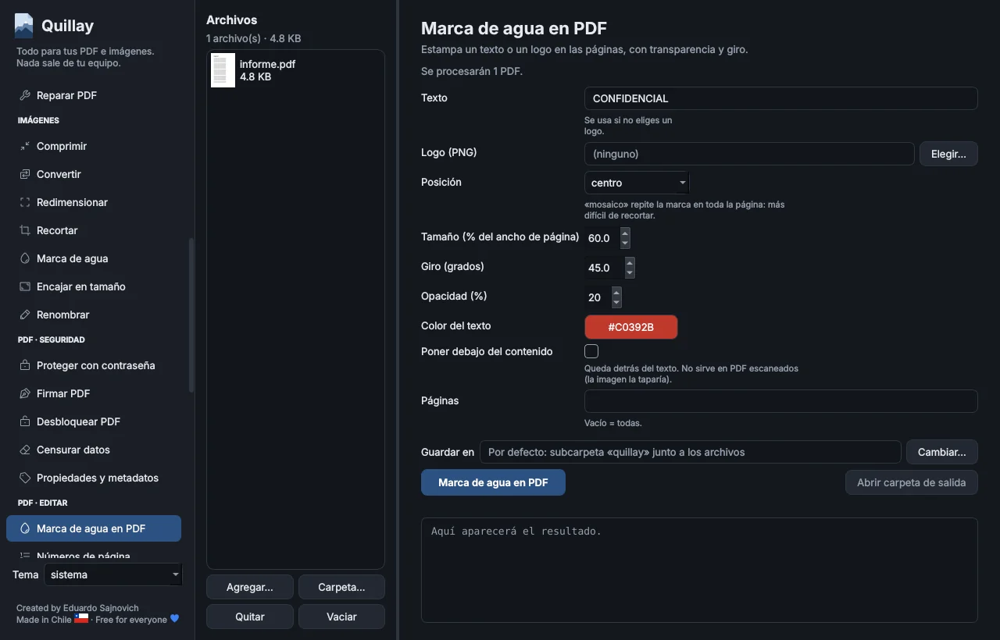
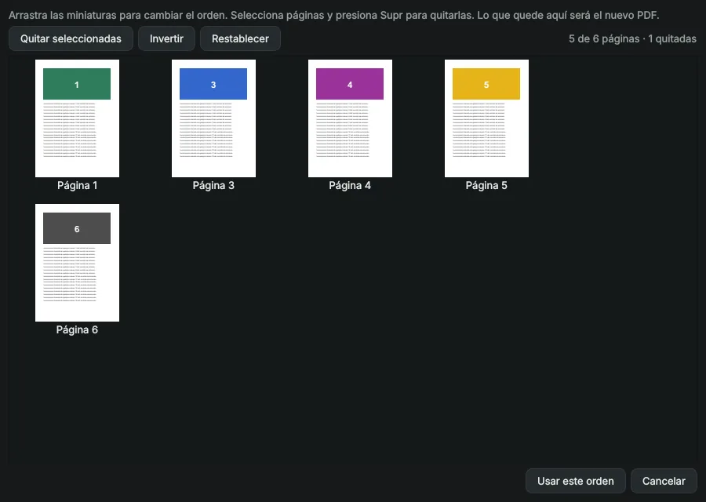

<div align="center">

**Español** · [English](README.en.md)


# Quillay

**Prepara tus imágenes para publicar: livianas, del tamaño justo y sin datos que no quieres compartir.**

Quillay automatiza lo que haces antes de subir una foto a tu sitio o a redes: la adapta, la aliviana, le quita la ubicación GPS y genera el código listo para pegar. Guarda esos pasos como **recetas** y repítelos con un clic o un comando.

[](https://github.com/sajnovich/quillay/actions/workflows/ci.yml)


[](LICENSE)
[](https://github.com/sajnovich/quillay/stargazers)
[](CONTRIBUTING.md)

**[Descargar](https://github.com/sajnovich/quillay/releases/latest)** · [Guía de contribución](CONTRIBUTING.md) · [Reportar un problema](https://github.com/sajnovich/quillay/issues/new/choose) · [Conversaciones](https://github.com/sajnovich/quillay/discussions)



</div>

> El *quillay* es un árbol nativo de Chile cuya corteza se usaba para limpiar. Esta app hace lo mismo con tus imágenes: las limpia antes de que salgan al mundo.

> [!TIP]
> **¿Quillay te sirve?** Dale una ⭐ arriba a la derecha. Es gratis, toma un segundo y ayuda a que más personas lo encuentren.

## Lo que hace distinto a Quillay

- **Recetas reutilizables.** Una receta es un archivo YAML con varios pasos (encajar → marca de agua → WebP sin GPS) que corres desde la ventana, la terminal o un script, y que puedes compartir con tu equipo.
- **Terminal de primera clase.** Cada herramienta es también un comando (`quillay favicons logo.png`), generado automáticamente desde el mismo código que la ventana, así que nunca se contradicen.
- **Hecho para la web.** Entrega archivos *y* el código: el `<head>` de los favicons, el `<picture>` con `srcset`, las variables CSS de tus colores y los marcadores de carga.
- **Privacidad antes de publicar.** Avisa qué fotos revelan dónde se tomaron, difumina rostros y encuentra duplicados sin borrar nada.
- **Local y sin cuentas.** Todo se procesa en tu equipo; no se sube nada a internet.

## Herramientas

| Categoría | Herramienta | Qué hace |
|---|---|---|
| **Automatizar** | Recetas | Cadenas de pasos en YAML: 5 incluidas, editor en la ventana y `quillay receta correr`. |
| **Web** | Favicons e íconos de app | `favicon.ico`, PNG, `apple-touch-icon`, ícono *maskable*, `site.webmanifest` y el `<head>` listo. |
| | Imágenes responsive | Varias anchuras × AVIF/WebP/JPG + el código `<picture>` con `width`/`height` (evita CLS). |
| | Tamaños para redes | Instagram, historias/Reels/Estados, LinkedIn, Facebook, X, YouTube y Open Graph. |
| | Colores de marca | Colores dominantes como variables CSS, con muestra PNG y valores RGB/HSL. |
| | Marcadores de carga | Miniaturas borrosas (LQIP) o la imagen como *data URI*, en JSON y CSS. |
| **Privacidad y orden** | Ubicación y metadatos | Indica qué fotos tienen **GPS**, cámara y fecha; crea copias limpias sin recomprimir los JPG. |
| | Difuminar caras y patentes | Detecta rostros y los oculta con desenfoque, pixelado o caja negra. |
| | Buscar duplicados | Encuentra fotos repetidas aunque cambien de nombre, tamaño o formato. Nunca borra: copia o mueve. |
| **Edición** | Convertir · Comprimir | JPG, PNG, WebP, AVIF, HEIC, TIFF, BMP y GIF; PNG a 256 colores y ancho máximo, con el ahorro total. |
| | Redimensionar · Recortar · Encajar | Por caja, ancho, alto o porcentaje; a proporción (1:1, 4:5, 9:16…); o a un tamaño exacto con bordes. |
| | Marca de agua | Tu logo PNG o un texto en cualquiera de 9 ubicaciones, con transparencia ajustable. |
| | Renombrar | Patrones con `{nombre}` `{n}` `{fecha}` `{ancho}` `{alto}`, con vista previa. |
| **PDF · Organizar** | Unir · Dividir · Ordenar y eliminar páginas · Rotar · Recortar márgenes | Ordena arrastrando miniaturas; divide por página, rangos o cada N; recorte automático del blanco. |
| **PDF · Optimizar** | Comprimir · Reparar | Tres niveles de compresión de las imágenes internas; reconstruye PDF dañados. |
| **PDF · Convertir** | Imágenes ↔ PDF · PDF → Word, PowerPoint y Excel · Office → PDF · HTML → PDF | Word con títulos y tablas; Excel con números en formato chileno; Office y web usan LibreOffice, Edge o Chrome si los tienes. |
| **PDF · Editar** | Números de página · Marca de agua · Formularios | «Página 3 de 10»; marca en mosaico; rellena un formulario por cada fila de un Excel o CSV. |
| **PDF · Revisar** | Comparar PDF | Informe de diferencias de texto y páginas lado a lado con los cambios en rojo. |
| **PDF · Seguridad** | Proteger · Desbloquear · Propiedades · Firmar · Censurar | AES-256; firma visual y digital con certificado `.p12`/`.pfx`; censura real de RUT, correos, teléfonos y patentes. |

<table>
  <tr>
    <td></td>
    <td></td>
  </tr>
  <tr>
    <td></td>
    <td></td>
  </tr>
  <tr>
    <td></td>
    <td></td>
  </tr>
</table>

## Instalación

### Opción 1 · Descargar el ejecutable (sin instalar Python)

Ve a **[Releases](https://github.com/sajnovich/quillay/releases)** y descarga el archivo de tu sistema:

| Sistema | Archivo | Cómo abrirlo |
|---|---|---|
| Windows 10/11 | `Quillay-<versión>-windows-x64.zip` | Descomprime y abre `Quillay.exe`. |
| macOS (Apple Silicon) | `Quillay-<versión>-macos-arm64.zip` | Descomprime y mueve `Quillay.app` a Aplicaciones. |
| Linux x86_64 | `Quillay-<versión>-linux-x86_64.tar.gz` | `tar xzf Quillay-*.tar.gz && ./Quillay/Quillay` |

> **Aviso de seguridad la primera vez.** Los ejecutables aún no están firmados digitalmente (cuesta dinero). Windows mostrará *"Windows protegió tu PC"* → **Más información → Ejecutar de todas formas**. En macOS: clic derecho sobre la app → **Abrir**.

### Opción 2 · Con Python (recomendado si programas)

Requiere Python 3.11 o superior.

```bash
git clone https://github.com/sajnovich/quillay.git
cd quillay
python3 -m venv .venv
source .venv/bin/activate          # Windows: .venv\Scripts\activate
pip install -e ".[gui]"
quillay-gui                        # abre la ventana
```

¿Solo quieres la terminal (por ejemplo en un servidor)? `pip install -e .` sin `[gui]` evita instalar Qt.

En **Debian/Ubuntu** puede faltar alguna librería de sistema para Qt:

```bash
sudo apt install python3-venv libegl1 libxkbcommon0 libxcb-cursor0
```

## Uso desde la terminal

```bash
quillay herramientas                                   # lista todo
quillay convertir fotos/ --formato webp --calidad 80   # carpeta completa
quillay comprimir *.png --png-reducir-colores -o livianas/
quillay favicons logo.png --nombre-sitio "Mi sitio" --color-tema "#2f7d5b"
quillay redes_sociales producto.jpg --plataformas instagram-post,historia
quillay metadatos foto.jpg                             # ¿tiene GPS?
quillay renombrar viaje/ --patron "{fecha}_{n}" --vista-previa
quillay imagenes_a_pdf escaneos/ --pagina oficio --nombre contrato
quillay duplicados ~/Fotos -r --accion copiar_grupos
quillay <herramienta> --help                           # todas las opciones
```

Por defecto los resultados se guardan en una subcarpeta `quillay/` junto a los originales. **Nunca se sobrescribe un archivo:** si existe, se crea `foto-1.jpg`.

## Recetas

Una receta es un archivo YAML legible:

```yaml
nombre: Web optimizado
descripcion: Reduce a máximo 1920 px, convierte a WebP y elimina el GPS.
pasos:
  - redimensionar: {modo: caja, ancho: 1920, alto: 1920}
  - marca_agua: {texto: "© Mi marca", opacidad: 50}
salida:
  formato: webp
  calidad: 80
  quitar_metadatos: true
  sufijo: -web
```

```bash
quillay receta lista
quillay receta correr web-optimizado fotos/ -o publicadas/
quillay receta correr ./mi-receta.yaml fotos/
quillay receta carpeta            # dónde se guardan tus recetas
```

**Incluidas:** `web-optimizado`, `instagram-cuadrado`, `anonimizar`, `catalogo-producto`, `miniaturas`.
**Pasos disponibles:** `redimensionar`, `recortar`, `encajar`, `marca_agua`, `difuminar`, `escala_grises`, `rotar`.

## Limitaciones conocidas

- **Detección de caras:** usa clasificadores Haar de OpenCV (rápidos y sin internet, pero clásicos). Pueden omitir caras pequeñas, de perfil o con poca luz. **Revisa siempre el resultado antes de publicar.**
- **Patentes:** experimental. El modelo incluido fue entrenado con patentes rusas y falla con frecuencia en las chilenas.
- **AVIF:** requiere Pillow 11.3 o superior (ya incluido en los ejecutables).
- **PDF escaneados:** sin OCR, PDF → Word/Excel y Censurar no "leen" texto dentro de imágenes. El OCR está en la hoja de ruta.
- **Office → PDF y HTML → PDF** necesitan LibreOffice o Edge/Chrome instalados (Quillay te avisa si faltan).
- **Tamaño del ejecutable:** ~155 MB comprimido, en buena parte por OpenCV. Está en la hoja de ruta reducirlo.

## Hoja de ruta

- [ ] Detector de caras moderno (YuNet/ONNX), más preciso y liviano que OpenCV completo
- [ ] Quitar fondo con IA (descarga opcional del modelo)
- [ ] OCR (extraer texto de imágenes y PDF escaneados)
- [ ] Editor visual de PDF (agregar texto e imágenes donde hagas clic)
- [ ] Constructor visual de recetas (sin escribir YAML)
- [ ] Vista previa antes/después en la ventana
- [ ] Interfaz en inglés y portugués
- [ ] Instaladores nativos: `.msi`/Inno Setup, `.dmg` y AppImage
- [ ] Firma de código en Windows y macOS

## Cómo ayudar

Quillay es un proyecto comunitario: **cualquier aporte suma, programes o no.**

| Si tienes… | Puedes… |
|---|---|
| 1 segundo | Darle una ⭐ al repositorio. |
| 5 minutos | Compartirlo con alguien que publica fotos, maneja un sitio web o una tienda en línea. |
| 15 minutos | [Reportar un error](https://github.com/sajnovich/quillay/issues/new?template=error.md) o [proponer una idea](https://github.com/sajnovich/quillay/issues/new?template=idea.md). |
| Una tarde | Escribir una receta útil, mejorar la documentación o traducir la interfaz. |
| Ganas de programar | Tomar un issue marcado [`buena primera tarea`](https://github.com/sajnovich/quillay/labels/buena%20primera%20tarea). |

Para programar, lee [CONTRIBUTING.md](CONTRIBUTING.md) y [docs/ARQUITECTURA.md](docs/ARQUITECTURA.md). Agregar una herramienta nueva es escribir una función con un decorador: aparece sola en la ventana, la terminal y las recetas.

### Personas que han contribuido

<a href="https://github.com/sajnovich/quillay/graphs/contributors">
  
</a>

### Estrellas en el tiempo

<a href="https://star-history.com/#sajnovich/quillay&Date">
  
</a>

## Créditos

Construido con [Pillow](https://python-pillow.org), [PySide6/Qt](https://doc.qt.io/qtforpython-6/), [OpenCV](https://opencv.org), [pypdfium2](https://github.com/pypdfium2-team/pypdfium2) y [pillow-heif](https://github.com/bigcat88/pillow_heif). Ver [THIRD_PARTY_NOTICES.md](THIRD_PARTY_NOTICES.md).

## Licencia

[MIT](LICENSE) © 2026 Eduardo Sajnovich. Puedes usar, copiar, modificar y distribuir Quillay libremente, incluso con fines comerciales, manteniendo el aviso de copyright.

Al participar en el proyecto aceptas el [código de conducta](CODE_OF_CONDUCT.md). Para reportar una vulnerabilidad, revisa [SECURITY.md](SECURITY.md).

<div align="center">

**Si llegaste hasta aquí, una ⭐ hace la diferencia.** Hecho en Chile 🇨🇱 para todo el mundo.

</div>
